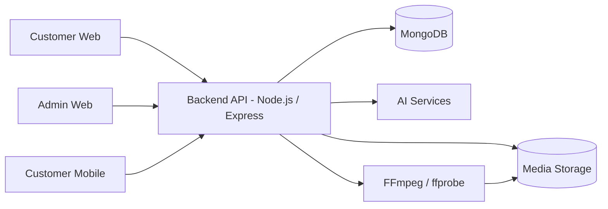
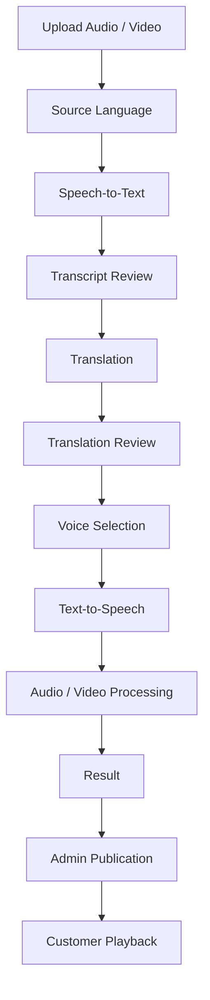

# Multilingual AI Narration

Hệ thống thuyết minh bảo tàng đa ngôn ngữ ứng dụng AI, gồm Customer Web, Admin Web, Customer Mobile và Backend API.

**Mục lục**

1. [Giới thiệu dự án](#1-giới-thiệu-dự-án)
2. [Chức năng chính](#2-chức-năng-chính)
3. [Technology Stack](#3-technology-stack)
4. [Kiến trúc hệ thống](#4-kiến-trúc-hệ-thống)
5. [Cấu trúc thư mục](#5-cấu-trúc-thư-mục)
6. [Quy trình xử lý AI](#6-quy-trình-xử-lý-ai)
7. [Cài đặt và chạy dự án](#7-cài-đặt-và-chạy-dự-án)
8. [Docker Deployment](#8-docker-deployment)

## 1. Giới thiệu dự án

Dự án hỗ trợ tải lên âm thanh/video, chuyển giọng nói thành văn bản, dịch nội dung và tạo giọng đọc thuyết minh AI. Nội dung và kết quả được quản lý theo dự án, ngôn ngữ và phiên bản.

Người dùng xem, phát và tải kết quả của mình. Quản trị viên quyết định nội dung nào được công khai cho khách tham quan. Customer Mobile dành cho khách hàng, không có giao diện Admin.

## 2. Chức năng chính

| Thành phần | Chức năng |
| --- | --- |
| Customer Web | Đăng ký/đăng nhập, dashboard, quản lý dự án, upload, chỉnh transcript/bản dịch, chọn voice, theo dõi xử lý, thư viện và kết quả |
| Admin Web | Quản lý người dùng, dự án, ProcessingJob, ngôn ngữ/voice, nhật ký và nội dung công khai |
| Customer Mobile | Quản lý dự án, thư viện, xem kết quả; truy cập bảo tàng và phát public audio/video theo ngôn ngữ |
| Backend API | JWT/RBAC/ownership, upload, STT, Translation, TTS, FFmpeg, Result và publication |

Public original audio, AI narration và generated MP4 có điều kiện công khai riêng. Duyệt audio không tự công khai video; video nguồn upload không được dùng làm public fallback.

## 3. Technology Stack

| Layer | Technologies |
| --- | --- |
| Backend | Node.js 22.23.3, Express 5, TypeScript, Mongoose, Zod |
| Customer/Admin Web | React 19, TypeScript, Vite 8 |
| Mobile | React Native, Expo SDK 58, Expo Router |
| Database/Security | MongoDB, JWT, bcryptjs, RBAC |
| AI/Media | Google Gemini, AI provider adapters, FFmpeg, ffprobe |
| Packaging/Automation | Docker Compose, Nginx, GitHub Actions |

Phiên bản dependency cụ thể nằm trong `package.json` và `package-lock.json` của từng ứng dụng.

## 4. Kiến trúc hệ thống

Các client giao tiếp với Backend qua REST API. Backend xử lý nghiệp vụ, AI, MongoDB và media storage.



Chi tiết: [Architecture](docs/ARCHITECTURE.md), [API](docs/API.md).

## 5. Cấu trúc thư mục

```text
multilingual-ai-narration/
├── backend/                  # Backend API, models, AI/media services và tests
├── frontend-web/             # Customer Web và public Museum
├── admin-web/                # Admin Web
├── frontend-mobile/          # Customer Mobile / Expo
├── infra/local-cd/acceptance/ # Compose, build/preflight và công cụ quản lý local
├── design/                   # Design tokens và tài liệu thiết kế
├── docs/                     # Tài liệu kỹ thuật
├── scripts/                  # Công cụ hỗ trợ phát triển
├── .github/workflows/        # GitHub Actions
└── README.md
```

## 6. Quy trình xử lý AI



ProcessingJob lưu trạng thái tác vụ. Người dùng kiểm tra transcript/bản dịch trước khi tạo giọng đọc; FFmpeg tạo MP4 khi phù hợp. Kết quả private không cần công khai để chủ sở hữu xem; Admin publication là bước riêng để phục vụ khách tham quan.

## 7. Cài đặt và chạy dự án

Cần Git, Node.js theo [`.nvmrc`](.nvmrc), MongoDB replica set hoặc Atlas riêng và FFmpeg/ffprobe cho xử lý media. Chuẩn bị từng `.env` từ template; không ghi secrets vào Git hoặc biến client public. AI LIVE cần provider/key/quota hợp lệ và có thể phát sinh chi phí.

```powershell
git clone https://github.com/vuvantai14/multilingual-ai-narration.git
cd multilingual-ai-narration
```

Chạy mỗi ứng dụng trong terminal riêng, bắt đầu từ thư mục gốc repository.

### Backend

```powershell
cd backend
npm ci
if (!(Test-Path .env)) { Copy-Item .env.example .env }
# Điền MONGODB_URI, hai JWT secrets khác nhau và các biến bắt buộc trước khi chạy.
npm run dev
```

API: http://localhost:8080/api · Health: http://localhost:8080/api/health.

### Customer Web

```powershell
cd frontend-web
npm ci
if (!(Test-Path .env)) { Copy-Item .env.example .env }
$env:VITE_API_BASE_URL = 'http://localhost:8080/api'
npm run dev -- --port 5173 --strictPort
```

Truy cập http://localhost:5173.

### Admin Web

```powershell
cd admin-web
npm ci
if (!(Test-Path .env)) { Copy-Item .env.example .env }
$env:VITE_API_BASE_URL = 'http://localhost:8080/api'
$env:VITE_PUBLIC_MUSEUM_URL = 'http://localhost:5173/'
npm run dev
```

Truy cập http://localhost:5174 bằng tài khoản Admin hợp lệ.

### Customer Mobile — Android

Cài Android Studio/SDK và khởi động emulator, hoặc dùng thiết bị Android tương thích Expo SDK 58.

```powershell
cd frontend-mobile
npm ci
if (!(Test-Path .env)) { Copy-Item .env.example .env }
$env:EXPO_PUBLIC_API_BASE_URL = 'http://10.0.2.2:8080/api'
npm run android
```

`10.0.2.2` dành cho Android Emulator mặc định. Điện thoại thật cần IP LAN của máy Backend, kết nối mạng phù hợp và firewall cho phép; không dùng localhost của điện thoại làm địa chỉ Backend.

Backend/Customer Web/Admin Web có `npm run build`; Backend sau build chạy bằng `npm start`. Mobile xuất bundle bằng `npx expo export --platform android --output-dir .expo/android-export` trong `frontend-mobile/`; bundle không phải APK/AAB và không thay thế nghiệm thu trên thiết bị.

Hướng dẫn thêm: [Local Development](docs/LOCAL_DEVELOPMENT.md), [UI](docs/UI.md), [Project Progress](docs/PROGRESS.md).

## 8. Docker Deployment

Môi trường **local acceptance**, không phải production. Cần Docker Desktop chạy Linux containers và PowerShell 5.1+; Mobile chạy ngoài Docker.

| Service | Truy cập |
| --- | --- |
| MongoDB | Không publish host port; database local `s424_acceptance`, replica set `s424rs` |
| Backend | Không publish host port; API qua frontend proxy |
| Customer Web | http://127.0.0.1:5280 |
| Admin Web | http://127.0.0.1:5281 |

Project `narration-s424-acceptance` dùng volumes/networks riêng, tách khỏi S39.6 và Atlas. API keys rỗng; smoke tests không gọi AI LIVE.

### Build và Preflight cho môi trường mới

```powershell
docker.exe version
docker.exe compose version
docker.exe image inspect mongo:8.0.17 --format '{{.Id}}'
$runId = 's424-20261116-example01'
powershell -File infra/local-cd/acceptance/Invoke-Acceptance.ps1 -Stage Build -RunId $runId
# Chỉ tiếp tục nếu Build PASS:
powershell -File infra/local-cd/acceptance/Invoke-Acceptance.ps1 -Stage Preflight -RunId $runId
```

Chọn RunId mới; image MongoDB phải có local, ports 5280/5281 trống và chưa có tài nguyên S42.4. Build tạo snapshot/images/manifest; Preflight kiểm tra cấu hình và ownership. **Hai stage không khởi động stack hoặc tự deploy.** Khởi tạo lần đầu cần bước triển khai được review riêng; không dùng chúng để resume stack hiện có.

### Quản lý stack đã nghiệm thu trên máy hiện tại

```powershell
powershell -File infra/local-cd/acceptance/Manage-Local.ps1 -Action Status
powershell -File infra/local-cd/acceptance/Manage-Local.ps1 -Action Logs -Service backend -Tail 50
# Start/Stop chỉ sau khi xác minh an toàn workload và dữ liệu:
powershell -File infra/local-cd/acceptance/Manage-Local.ps1 -Action Start
powershell -File infra/local-cd/acceptance/Manage-Local.ps1 -Action Stop
```

Manager gắn với RunId `s424-20261115t215313` và evidence local trong `.state` được Git ignore; clone repository không tự có evidence. Script xác minh IDs/mounts/resources, không build/recreate hoặc xóa dữ liệu. Status hiển thị health; `/api/health` qua hai frontend kiểm tra kết nối database. `/local-ready` thuộc Nginx, không phải route Backend.

**Phạm vi nghiệm thu:** build/runtime local của RunId trên và static management tests đã PASS. **Chưa nghiệm thu:** runtime Stop/Start, backup/restore, production/multi-machine deployment. Kết quả local không bảo đảm AI LIVE, media processing hoặc Android runtime; không đưa `.env`, uploads, backup hay `.state` vào commit.
