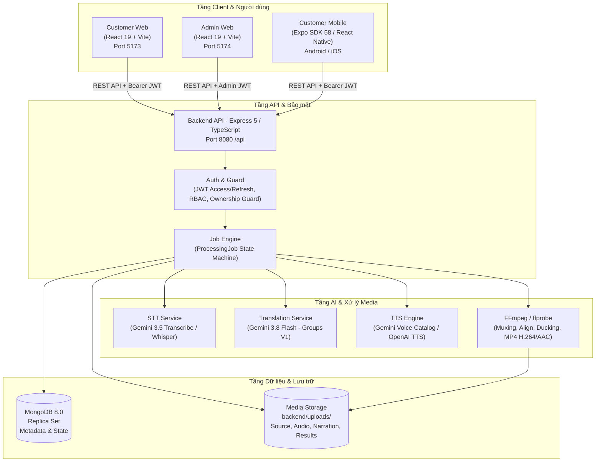
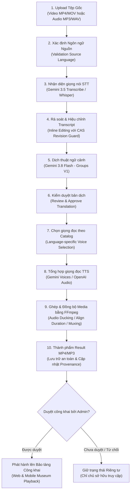

# Multilingual AI Narration System
### Hệ Thống Thuyết Minh Bảo Tàng Thông Minh Đa Ngôn Ngữ Ứng Dụng Trí Tuệ Nhân Tạo (AI)

Hệ thống toàn diện ứng dụng AI phục vụ thuyết minh bảo tàng, di tích và không gian triển lãm văn hóa đa ngôn ngữ. Nền tảng hỗ trợ tự động hóa toàn bộ quy trình: từ tải lên tệp đa phương tiện (âm thanh/video gốc), nhận diện giọng nói thành văn bản có gán nhãn thời gian (STT), biên dịch thuật ngữ ngữ cảnh (Translation), tổng hợp giọng đọc bản ngữ truyền cảm (TTS), đến xử lý đồng bộ video/âm thanh thành phẩm qua FFmpeg.

Dự án bao gồm 4 phân hệ chính:
- **Customer Web**: Cổng thông tin cho khách hàng và người sáng tạo nội dung quản lý dự án, kiểm duyệt phụ đề/bản dịch và trải nghiệm bảo tàng số.
- **Admin Web**: Hệ thống quản trị nội dung độc lập quản lý người dùng, kiểm duyệt tác vụ AI, giám sát quy trình và phê duyệt phát hành thuyết minh công khai.
- **Customer Mobile**: Ứng dụng di động (React Native/Expo) dành cho khách tham quan tra cứu hiện vật, quét mã QR và nghe/xem thuyết minh đa ngôn ngữ mượt mà.
- **Backend API**: Nền tảng máy chủ Node.js/Express điều phối chuỗi xử lý AI, xác thực JWT/RBAC, quản lý quyền sở hữu dữ liệu, lưu trữ media và xuất bản nội dung.

---

## Mục lục

1. [Tổng quan & Mục tiêu dự án](#1-tổng-quan--mục-tiêu-dự-án)
2. [Kiến trúc hệ thống & Chuỗi xác thực (Architecture & Provenance)](#2-kiến-trúc-hệ-thống--chuỗi-xác-thực-architecture--provenance)
3. [Bảng công nghệ chi tiết (Full Tech Stack)](#3-bảng-công-nghệ-chi-tiết-full-tech-stack)
4. [Cấu trúc thư mục dự án](#4-cấu-trúc-thư-mục-dự-án)
5. [Quy trình xử lý AI & Media Pipeline](#5-quy-trình-xử-lý-ai--media-pipeline)
6. [Phân quyền & Chính sách xuất bản bảo tàng (Publication Policy)](#6-phân-quyền--chính-sách-xuất-bản-bảo-tàng-publication-policy)
7. [Hướng dẫn cài đặt & Chạy cục bộ (Local Development)](#7-hướng-dẫn-cài-đặt--chạy-cục-bộ-local-development)
8. [Hướng dẫn Cài đặt & Tích hợp Ngrok (Kiểm thử Di động & Remote Tunnels)](#8-hướng-dẫn-cài-đặt--tích-hợp-ngrok-kiểm-thử-di-động--remote-tunnels)
9. [Hướng dẫn triển khai bằng Docker (Docker Deployment)](#9-hướng-dẫn-triển-khai-bằng-docker-docker-deployment)
10. [Tài khoản mặc định & Dữ liệu mẫu (Seed Data)](#10-tài-khoản-mặc-định--dữ-liệu-mẫu-seed-data)
11. [Kiểm thử & Đảm bảo chất lượng (QA & Testing)](#11-kiểm-thử--đảm-bảo-chất-lượng-qa--testing)
12. [Quy chuẩn mã nguồn & Bảo mật hệ thống](#12-quy-chuẩn-mã-nguồn--bảo-mật-hệ-thống)

---

## 1. Tổng quan & Mục tiêu dự án

Tại các bảo tàng và di tích lịch sử, rào cản ngôn ngữ là thách thức lớn đối với du khách quốc tế. Việc thuê hướng dẫn viên hoặc đầu tư thiết bị Audio Guide truyền thống thường tốn kém và khó cập nhật nội dung.

**Multilingual AI Narration** giải quyết bài toán này bằng cách:
- **Tự động hóa hoàn toàn**: Biến một video hoặc bản ghi âm thuyết minh tiếng Việt thành phiên bản thuyết minh tiếng Anh, Hàn Quốc, Nhật Bản, Pháp,... với chất lượng giọng đọc tự nhiên.
- **Bảo toàn ngữ cảnh lịch sử & văn hóa**: Sử dụng AI (Google Gemini) với cơ chế dịch nhóm ngữ cảnh (`Groups V1`), giữ đúng thuật ngữ chuyên môn và danh từ riêng di tích.
- **Kiểm duyệt hai tầng (Human-in-the-loop)**: Cho phép người biên tập rà soát/sửa chữa transcript và bản dịch trước khi sinh giọng đọc (TTS) và dựng video.
- **Tiếp cận linh hoạt cho khách tham quan**: Khách chỉ cần mở ứng dụng di động hoặc quét mã QR tại chân hiện vật để nghe thuyết minh bằng chính ngôn ngữ mẹ đẻ mà không cần cài đặt phức tạp.

---

## 2. Kiến trúc hệ thống & Chuỗi xác thực (Architecture & Provenance)

### Sơ đồ kiến trúc tổng thể



### Chuỗi định danh Provenance & Revision CAS Guard

Nhằm đảm bảo tính toàn vẹn dữ liệu và chống hiện tượng dữ liệu lỗi thời (*stale state*) khi người dùng chỉnh sửa transcript hoặc bản dịch ở giữa quy trình, hệ thống áp dụng chuỗi phụ thuộc định danh đơn điệu:

$$\text{Transcript}(id, rev) \longrightarrow \text{Translation}(id, rev, srcRev) \longrightarrow \text{Narration}(id, rev, srcRev) \longrightarrow \text{Result}(id, srcRev)$$

- **Nguyên tắc Compare-And-Set (CAS)**: Khi người dùng sửa một phân đoạn transcript hoặc bản dịch, `revision` tăng lên đơn vị tiếp theo.
- **Bảo vệ bất đồng bộ**: Khi một tiến trình TTS hoặc FFmpeg hoàn tất, hệ thống đối chiếu lại `sourceRevision`. Nếu nguồn đã bị sửa đổi trong lúc đang render, kết quả render cũ bị đánh dấu `STALE` và không được ghi nhận là artifact `CURRENT`.

---

## 3. Bảng công nghệ chi tiết (Full Tech Stack)

| Phân hệ / Tầng | Công nghệ / Thư viện chính | Phiên bản | Vai trò & Đặc điểm |
| :--- | :--- | :--- | :--- |
| **Backend API** | Node.js | `>=20.x` (LTS 22.23.3) | Nền tảng runtime server-side |
| | Express.js | `^5.1.0` | HTTP Server framework thế hệ mới |
| | TypeScript | `^5.9.3` | Kiểu dữ liệu tĩnh nghiêm ngặt (`strict: true`) |
| | Mongoose / MongoDB | `^9.0.0` / `8.0.x` | ODM và cơ sở dữ liệu NoSQL (yêu cầu Replica Set cho Transaction) |
| | Zod | `^4.6.5` | Validation dữ liệu đầu vào request body/query/params |
| | jsonwebtoken & bcryptjs | `^9.0.3` / `^3.0.3` | Mã hóa mật khẩu an toàn và cấp phát JWT Access/Refresh tokens |
| | Multer | `^2.4.0` | Xử lý upload tệp đa phương tiện giới hạn kích thước |
| **AI & Media Engine** | Google GenAI SDK | `@google/genai 2.28.0` | Tích hợp Gemini 3.5 Transcribe, Gemini 3.8 Flash Translation, Gemini TTS |
| | FFmpeg & ffprobe | `7.x+` | Trích xuất âm thanh, gộp luồng, đồng bộ độ dài, encode video H.264/AAC |
| **Customer Web** | React | `^19.2.8` | UI Library render client-side |
| | Vite | `^8.3.0` | Build tool và dev server cực nhanh |
| | React Router DOM | `^7.18.4` | Điều hướng SPA cho Customer Web và Museum View |
| | Oxlint | `^1.81.0` | Linter tốc độ cao theo chuẩn Rust |
| **Admin Web** | React | `^19.2.8` | Ứng dụng quản trị riêng biệt |
| | Vite & TypeScript | `^8.3.0` / `~6.0.2` | Đóng gói tối ưu hóa cho quản trị viên |
| | React Router DOM | `^7.18.4` | Quản lý định tuyến bảo mật cho role `ADMIN` |
| **Customer Mobile** | React Native | `0.88.0` | Framework di động đa nền tảng |
| | Expo SDK | `^58.0.0` | Nền tảng phát triển ứng dụng di động hiện đại |
| | Expo Router | `~58.0.25` | Điều hướng tệp theo chuẩn file-based routing |
| | expo-video & expo-audio | `~58.0.12` / `~58.0.10` | Trình phát video/âm thanh bản địa với khả năng seek mượt mà |
| | expo-secure-store | `~58.0.2` | Lưu trữ token xác thực an toàn trên Keychain/Keystore |
| **DevOps & Infra** | Docker & Compose | `28.x+` / Compose v2 | Container hóa backend, mongo replica set, frontend nginx |
| | Nginx | `Alpine` | Reverse proxy phục vụ static frontend và proxy API `/api` |

---

## 4. Cấu trúc thư mục dự án

```text
multilingual-ai-narration/
├── backend/                        # Máy chủ Backend API (Node.js + Express + TypeScript)
│   ├── src/
│   │   ├── config/                 # Cấu hình Database, biến môi trường, server options
│   │   ├── constants/              # Định nghĩa HTTP status, error codes, role enums
│   │   ├── controllers/            # Điều khiển nghiệp vụ API (Auth, Project, Admin, Voice,...)
│   │   ├── middleware/             # Middleware xác thực JWT, RBAC, Rate-limit, Upload filter
│   │   ├── models/                 # Mongoose Schemas (User, Project, Media, Transcript, Translation,...)
│   │   ├── routes/                 # Khai báo Express Routers (/api/v1/...)
│   │   ├── scripts/                # Script khởi tạo Admin, seed ngôn ngữ, seed catalog giọng đọc
│   │   ├── services/               # Logic nghiệp vụ, AI Pipeline, FFmpeg wrapper, CAS Provenance
│   │   ├── types/                  # TypeScript domain interfaces
│   │   ├── utils/                  # Tiện ích mã hóa, logger, xử lý tệp tin
│   │   ├── validators/             # Zod schemas kiểm tra dữ liệu đầu vào
│   │   ├── app.ts                  # Cấu hình Express app và middleware
│   │   └── server.ts               # Điểm khởi động HTTP server và kết nối cơ sở dữ liệu
│   ├── staging/                    # Health check & preflight scripts cho Docker
│   ├── tests/                      # Bộ kiểm thử tích hợp (Auth, Workflow, Media, Provenance)
│   ├── uploads/                    # Thư mục lưu media cục bộ (được gitignore an toàn)
│   │   ├── source/                 # Video/Audio gốc người dùng tải lên
│   │   ├── audio/                  # Audio trích xuất từ video nguồn
│   │   ├── narrations/             # File âm thanh giọng đọc TTS đã tạo
│   │   └── results/                # Video/Audio hoàn thiện đã ghép thuyết minh
│   ├── Dockerfile                  # Multi-stage Docker build với FFmpeg tích hợp
│   └── package.json
│
├── frontend-web/                   # Ứng dụng Customer Web & Triển lãm số công khai (React 19 + Vite)
│   ├── src/
│   │   ├── components/             # Reusable UI components (Modals, Dialogs, Buttons, Layouts)
│   │   ├── features/               # Module chức năng (Auth, ProjectWorkspace, Museum, Languages)
│   │   ├── pages/                  # Trang giao diện (Dashboard, Workspace, Museum, Login, Register)
│   │   ├── routes/                 # Định tuyến React Router v7
│   │   ├── services/               # API clients giao tiếp với backend
│   │   └── styles/                 # Thiết kế token theo hệ thống design chuẩn
│   ├── tests/                      # Kiểm thử giao diện và luồng dữ liệu
│   └── vite.config.ts
│
├── admin-web/                      # Ứng dụng quản trị độc lập dành cho ban quản lý (Admin Web)
│   ├── src/
│   │   ├── components/             # Các dialog kiểm duyệt, bảng quản lý người dùng, modal duyệt video
│   │   ├── pages/                  # Quản lý người dùng, duyệt dự án, quản trị ngôn ngữ, log hệ thống
│   │   ├── services/               # Admin API clients (Kiểm duyệt, quản lý quota, CAS publication)
│   │   └── routes/                 # Định tuyến độc lập với cổng riêng biệt (5174)
│   ├── tests/                      # Kiểm thử luồng quản trị và quyền hạn Admin
│   └── vite.config.ts
│
├── frontend-mobile/                # Ứng dụng di động dành cho khách tham quan (React Native / Expo SDK 58)
│   ├── src/
│   │   ├── app/                    # File-based routing (Trang chủ bảo tàng, quét QR, phát thuyết minh)
│   │   ├── components/             # Video player, audio player, bộ chọn ngôn ngữ, thẻ hiện vật
│   │   └── services/               # Giao tiếp API qua IP mạng cục bộ (LAN IP)
│   ├── tests/                      # Kiểm thử tương thích và luồng phát media công khai
│   └── app.json                    # Cấu hình Expo và quyền truy cập thiết bị
│
├── infra/                          # Hạ tầng triển khai cục bộ và nghiệm thu (Local Acceptance & Docker)
│   ├── local-cd/acceptance/        # Docker Compose, script tự động hóa kiểm tra và quản lý container
│   └── mongodb-integration/        # Cấu hình khởi tạo MongoDB Replica Set cục bộ
│
├── design/                         # Hướng dẫn thiết kế, bảng màu, typography và token chuẩn
├── docs/                           # Tài liệu kiến trúc, đặc tả API, hướng dẫn nâng cấp SDK
└── scripts/                        # Script tiện ích kiểm tra tính đồng bộ giao diện Web - Mobile
```

---

## 5. Quy trình xử lý AI & Media Pipeline

Hệ thống xử lý media trải qua 10 giai đoạn được kiểm soát chặt chẽ bởi máy trạng thái (*State Machine*):



### Chi tiết các bước xử lý:
1. **Upload Media**: Hỗ trợ tệp dung lượng tối đa 500MB (hoặc cấu hình qua `MAX_UPLOAD_SIZE_MB`). Tên tệp được băm ngẫu nhiên dạng UUID chống tấn công Path Traversal.
2. **Trích xuất Audio & STT**: Tự động bóc tách audio 16kHz mono nếu đầu vào là video; gửi đến AI engine để tạo danh sách segment có mốc thời gian chính xác (`startTime`, `endTime`, `text`).
3. **Hiệu chỉnh Transcript**: Người biên tập có thể sửa đổi nội dung phụ đề. Mọi sửa đổi kích hoạt cơ chế `revision` tăng dần để vô hiệu hóa các bản dịch cũ dựa trên transcript cũ.
4. **Dịch thuật thông minh (`Groups V1`)**: Không dịch từng dòng đơn lẻ mà phân nhóm các câu liền kề nhằm giữ trọn vẹn ngữ cảnh của đoạn văn, dịch chính xác danh từ lịch sử của hiện vật.
5. **Tổng hợp giọng đọc (TTS)**: Kết hợp các giọng đọc tiếng Việt, Anh, Hàn, Nhật tự nhiên với tốc độ đọc có thể tùy chỉnh.
6. **Ghép nối FFmpeg**:
   - Tự động căn chỉnh độ dài âm thanh thuyết minh khớp với video nguồn (`apad` nếu thuyết minh ngắn hơn, cắt tỉa nếu dài hơn).
   - Hạ âm lượng video gốc (audio ducking) để làm nổi bật giọng thuyết minh.
   - Encode định dạng chuẩn quốc tế: Video H.264 và Audio AAC, hỗ trợ streaming HTTP Range Requests.

---

## 6. Phân quyền & Chính sách xuất bản bảo tàng (Publication Policy)

Hệ thống tuân thủ nghiêm ngặt mô hình phân quyền kép: **RBAC** (*Role-Based Access Control*) kết hợp **Resource Ownership** (*Quyền sở hữu tài nguyên*):

| Quyền hạn / Thao tác | Khách vãng lai (Guest) | Khách hàng (Customer) | Quản trị viên (Admin) |
| :--- | :---: | :---: | :---: |
| Xem & nghe thuyết minh bảo tàng công khai | Có | Có | Có |
| Quét mã QR hiện vật tại bảo tàng | Có | Có | Có |
| Đăng ký & Đăng nhập tài khoản | Có | Có | Có |
| Tạo dự án & Upload media của riêng mình | Không | Có | Có |
| Hiệu chỉnh transcript/dịch của dự án riêng | Không | Có | Có |
| Truy cập dự án của người dùng khác | Không | **Tuyệt đối cấm** | Xem/Kiểm duyệt |
| Quản lý tài khoản người dùng, khóa tài khoản | Không | Không | Có |
| Duyệt xuất bản Audio/Video lên bảo tàng | Không | Không | Có |

### Ba nguyên tắc xuất bản độc lập bắt buộc:
1. **Phân lập tuyệt đối giữa các loại nội dung**: Âm thanh gốc (`Original Audio`), Giọng đọc AI (`AI Narration`), và Video thành phẩm (`Generated Video MP4`) có cờ duyệt và phiên bản CAS độc lập.
2. **Không tự động công khai chéo**: Việc quản trị viên duyệt thuyết minh Audio **không đồng nghĩa** với việc video MP4 tự động được phát hành ra công chúng.
3. **Chống fallback nguy hiểm**: Video thô người dùng tải lên ban đầu tuyệt đối **không bao giờ** được sử dụng làm video công khai thay thế nếu video thành phẩm chưa được tạo hoặc chưa được Admin phê duyệt.

---

## 7. Hướng dẫn cài đặt & Chạy cục bộ (Local Development)

### A. Yêu cầu tiên quyết (Prerequisites)
- **Node.js**: Phiên bản `>= 20.x` (khuyến nghị `22.23.3` theo `.nvmrc`).
- **npm**: Phiên bản `>= 10.x`.
- **MongoDB**: Bản cài đặt cục bộ (MongoDB 7.0/8.0) hoặc MongoDB Atlas.
  > [!IMPORTANT]
  > MongoDB phải được cấu hình chạy dưới dạng **Replica Set** (ví dụ `rs0`) để hỗ trợ MongoDB Transactions (bắt buộc cho cơ chế CAS và Provenance Chain).
- **FFmpeg & ffprobe**: Đã cài đặt trên máy và có thể gọi trực tiếp từ dòng lệnh (`ffmpeg -version`).
- **Git**: Đã cài đặt trên hệ điều hành.
- *(Tùy chọn cho Mobile)*: Cài đặt **Android Studio** (kèm Android Emulator) hoặc cài ứng dụng **Expo Go** trên điện thoại thông minh cùng mạng LAN.

---

### B. Cấu hình biến môi trường (.env)

#### 1. Cấu hình Backend (`backend/.env`)
Sao chép tệp mẫu và chỉnh sửa các biến cần thiết:
```bash
cd backend
cp .env.example .env
```
Nội dung tối thiểu cần thiết lập trong `backend/.env`:
```dotenv
PORT=8080
NODE_ENV=development

# Kết nối MongoDB (bắt buộc có replicaSet)
MONGODB_URI=mongodb://127.0.0.1:27017/multilingual_ai_narration?replicaSet=rs0

# Domain được phép truy cập CORS
CORS_ORIGINS=http://localhost:5173,http://localhost:5174

# Thư mục lưu media & giới hạn tải lên
UPLOAD_DIR=uploads
MAX_UPLOAD_SIZE_MB=200

# Khóa bí mật JWT (bắt buộc 2 khóa khác nhau, chuỗi ngẫu nhiên dài)
JWT_ACCESS_SECRET=your_super_secret_jwt_access_key_string_32_chars
JWT_ACCESS_EXPIRES_IN=15m
JWT_REFRESH_SECRET=your_super_secret_jwt_refresh_key_string_32_chars
JWT_REFRESH_EXPIRES_IN=7d

# Thông tin tài khoản Admin tự động khởi tạo khi chạy seed
ADMIN_SEED_NAME=System Administrator
ADMIN_SEED_EMAIL=admin@museum.local
ADMIN_SEED_PASSWORD=AdminSecurePassword123!

# Cấu hình AI Provider (Google Gemini)
STT_PROVIDER=gemini
GEMINI_API_KEY=AIzaSyYourGeminiApiKeyHere
GEMINI_STT_MODEL=gemini-3.5-transcribe

TRANSLATION_PROVIDER=gemini
GEMINI_TRANSLATION_MODEL=gemini-3.8-flash
CUSTOMER_TRANSLATION_ENABLED=true
CUSTOMER_TRANSLATION_METHOD=GROUPS_V1
GROUP_TRANSLATION_ENABLED=true

# Cấu hình Voice TTS
TTS_PROVIDER=openai
TTS_MODEL=gpt-4o-mini-tts
TTS_DEFAULT_VOICE=coral
TTS_AUDIO_FORMAT=mp3

# Đường dẫn nhị phân FFmpeg
FFMPEG_PATH=ffmpeg
FFPROBE_PATH=ffprobe
FFMPEG_TIMEOUT_MS=300000
```

#### 2. Cấu hình Customer Web (`frontend-web/.env`)
```dotenv
VITE_API_BASE_URL=http://localhost:8080/api
VITE_CUSTOMER_TRANSLATION_ENABLED=true
VITE_GROUP_TRANSLATION_ENABLED=true
```

#### 3. Cấu hình Admin Web (`admin-web/.env`)
```dotenv
VITE_API_BASE_URL=http://localhost:8080/api
VITE_PUBLIC_MUSEUM_URL=http://localhost:5173/
```

#### 4. Cấu hình Customer Mobile (`frontend-mobile/.env`)
```dotenv
# Sử dụng 10.0.2.2 cho Android Emulator hoặc IP LAN máy tính nếu chạy Expo Go trên điện thoại thật
EXPO_PUBLIC_API_BASE_URL=http://10.0.2.2:8080/api
# Hoặc: EXPO_PUBLIC_API_BASE_URL=http://192.168.1.50:8080/api
```

---

### C. Khởi động từng phân hệ (Từng bước chi tiết)

Mở 4 cửa sổ Terminal riêng biệt cho 4 phân hệ (khởi đầu từ thư mục gốc của repository):

#### Terminal 1: Khởi động Backend API & Khởi tạo Dữ liệu
```bash
# 1. Di chuyển vào thư mục backend
cd backend

# 2. Cài đặt các gói phụ thuộc
npm ci

# 3. Khởi tạo tài khoản Quản trị viên mặc định
npm run seed:admin

# 4. Khởi tạo danh mục Ngôn ngữ chuẩn (Việt, Anh, Nhật, Hàn, Pháp,...)
npm run seed:languages

# 5. Khởi tạo danh mục Giọng đọc AI (Voice Catalog)
npm run seed:voices:gemini

# 6. Khởi động Backend ở chế độ phát triển
npm run dev
```
- **Endpoint API**: `http://localhost:8080/api`
- **Kiểm tra sức khỏe**: `http://localhost:8080/api/health`

#### Terminal 2: Khởi động Customer Web
```bash
cd frontend-web
npm ci
npm run dev -- --port 5173 --strictPort
```
- Truy cập trình duyệt: `http://localhost:5173`

#### Terminal 3: Khởi động Admin Web
```bash
cd admin-web
npm ci
npm run dev -- --port 5174 --strictPort
```
- Truy cập trình duyệt: `http://localhost:5174` (Đăng nhập bằng tài khoản Admin đã cấu hình ở bước seed).

#### Terminal 4: Khởi động Customer Mobile (Expo)
```bash
cd frontend-mobile
npm ci

# Chạy trên Android Emulator
npm run android

# Hoặc mở giao diện chọn thiết bị (quét mã QR qua Expo Go)
npm start
```

---

## 8. Hướng dẫn Cài đặt & Tích hợp Ngrok (Kiểm thử Di động & Remote Tunnels)

Trong quá trình phát triển và kiểm thử thực tế, việc kết nối ứng dụng di động (**Customer Mobile**) trên điện thoại thật (Android / iOS) với máy chủ Backend chạy cục bộ gặp nhiều rào cản:
- Điện thoại và máy tính không cùng một mạng Wi-Fi (hoặc điện thoại dùng mạng 4G/5G).
- Bộ phát Wi-Fi bật chế độ cách ly bảo mật (*AP Client Isolation*), ngăn các thiết bị trong mạng LAN kết nối với nhau.
- Tường lửa (Firewall) hoặc router NAT chặn cổng `8080`.

**Ngrok** tạo một đường hầm mã hóa an toàn (Secure Tunnel) với URL công khai dạng HTTPS (ví dụ `https://xyz.ngrok-free.app`), chuyển tiếp toàn bộ lưu lượng về Backend `localhost:8080` trên máy phát triển mà không cần mở cổng router (Port Forwarding).

---

### A. Cài đặt Ngrok & Thiết lập Authtoken

#### 1. Cài đặt Ngrok CLI
Chọn một trong các phương thức cài đặt phù hợp với hệ điều hành:

- **Windows (khuyến nghị qua Winget hoặc Chocolatey)**:
  ```powershell
  # Qua Windows Package Manager (Winget)
  winget install ngrok.ngrok

  # Hoặc qua Chocolatey
  choco install ngrok
  ```
  *(Hoặc tải file `ngrok.exe` trực tiếp từ [ngrok.com/download](https://ngrok.com/download) và đặt vào thư mục có trong biến môi trường `PATH`).*

- **macOS (qua Homebrew)**:
  ```bash
  brew install ngrok/ngrok/ngrok
  ```

- **Linux (Debian/Ubuntu)**:
  ```bash
  curl -sSL https://ngrok-agent.s3.amazonaws.com/ngrok.asc | sudo tee /etc/apt/trusted.gpg.d/ngrok.asc >/dev/null
  echo "deb https://ngrok-agent.s3.amazonaws.com buster main" | sudo tee /etc/apt/sources.list.d/ngrok.list
  sudo apt update && sudo apt install ngrok
  ```

- **Hoặc cài đặt toàn cục qua npm**:
  ```bash
  npm install -g ngrok
  ```

#### 2. Kích hoạt Authtoken
1. Đăng ký tài khoản miễn phí tại [dashboard.ngrok.com](https://dashboard.ngrok.com).
2. Lấy mã Authtoken cá nhân tại mục **Your Authtoken**.
3. Lưu token vào hệ thống bằng lệnh:
   ```bash
   ngrok config add-authtoken <YOUR_NGROK_AUTHTOKEN>
   ```

---

### B. Cơ chế Tích hợp Ngrok có sẵn trong Hệ thống

Mã nguồn dự án đã được tích hợp sẵn sàng hỗ trợ Ngrok:
- **Tầng Backend CORS (`backend/src/app.ts`)**: Hàm `isAllowedDevOrigin` tự động kiểm tra và chấp thuận mọi tên miền kết thúc bằng `.ngrok-free.app`, `.ngrok-free.dev`, `.ngrok.io`, cũng như scheme nội bộ của Expo `exp://` khi ở môi trường `NODE_ENV=development`. Bạn không cần chỉnh sửa whitelist CORS thủ công.
- **Tầng Mobile (`frontend-mobile/package.json`)**: Đã cài đặt sẵn thư viện `@expo/ngrok`, cho phép Expo CLI khởi chạy Metro Bundler ở chế độ đường hầm độc lập.

---

### C. Quy trình Từng Bước Tích hợp & Kiểm thử Di động

#### Bước 1: Mở đường hầm cho Backend API
Mở một cửa sổ Terminal riêng và chạy:
```bash
ngrok http 8080
```
*(Nếu bạn đã tạo một Static Domain miễn phí trên Ngrok Dashboard, có thể dùng: `ngrok http --domain=ten-mien-cua-ban.ngrok-free.app 8080`)*

Màn hình Ngrok sẽ hiển thị:
```text
Forwarding    https://1a2b-3c4d.ngrok-free.app -> http://localhost:8080
```
> Hãy sao chép địa chỉ `https://1a2b-3c4d.ngrok-free.app`.

#### Bước 2: Cấu hình biến môi trường cho Ứng dụng Mobile
Mở tệp `frontend-mobile/.env` và trỏ biến `EXPO_PUBLIC_API_BASE_URL` đến đường hầm Ngrok (lưu ý kèm hậu tố `/api`):
```dotenv
EXPO_PUBLIC_API_BASE_URL=https://1a2b-3c4d.ngrok-free.app/api
```

#### Bước 3: Khởi chạy Expo Metro Bundler qua Tunnel
Tại thư mục `frontend-mobile/`, khởi động Expo với cờ `--tunnel`:
```bash
cd frontend-mobile
npx expo start --tunnel
```
*(Hoặc dùng lệnh `npm start -- --tunnel`)*.

#### Bước 4: Trải nghiệm trên Điện thoại Thật
1. Cài đặt ứng dụng **Expo Go** từ Google Play Store (Android) hoặc Apple App Store (iOS).
2. Dùng camera điện thoại (iOS) hoặc tính năng quét mã trong Expo Go (Android) để quét mã QR hiển thị trên Terminal.
3. Ứng dụng sẽ tự động tải JavaScript bundle qua đường hầm Ngrok.
4. Mọi tương tác trên điện thoại (đăng nhập, tải danh sách hiện vật, phát âm thanh thuyết minh AI, quét mã QR di tích) sẽ gửi trực tiếp đến Backend đang chạy trên máy tính phát triển mà không bị giới hạn mạng.

#### Bước 5: (Tùy chọn) Kiểm thử Customer Web trên Trình duyệt Điện thoại
Nếu muốn kiểm thử giao diện Customer Web của bảo tàng trên trình duyệt Safari/Chrome của điện thoại:
1. Mở thêm một tunnel cho web: `ngrok http 5173`
2. Cập nhật `frontend-web/.env`:
   ```dotenv
   VITE_API_BASE_URL=https://1a2b-3c4d.ngrok-free.app/api
   ```
3. Mở địa chỉ HTTPS của cổng 5173 trên trình duyệt điện thoại để trải nghiệm.

---

### D. Các lưu ý quan trọng khi dùng Ngrok
> [!TIP]
> **Static Domain miễn phí**: Tài khoản Ngrok miễn phí được cấp 1 Static Domain cố định (ví dụ `example.ngrok-free.app`). Hãy sử dụng tham số `--domain` để giữ nguyên URL cố định, tránh phải sửa lại file `.env` mỗi lần khởi động lại máy.

> [!NOTE]
> **Bỏ qua trang cảnh báo Ngrok Free**: Khi gọi REST API từ ứng dụng Mobile (`fetch`), dữ liệu truyền nhận dạng JSON sẽ tự động đi qua tunnel mà không bị chặn. Nếu kiểm tra API trên trình duyệt Web và gặp trang cảnh báo của Ngrok, chỉ cần nhấn nút **Visit Site** hoặc gắn header `ngrok-skip-browser-warning: 69420`.

> [!CAUTION]
> **Bảo mật Authtoken**: Tuyệt đối không commit Authtoken cá nhân hoặc tệp cấu hình `ngrok.yml` lên kho lưu trữ Git.

---

## 9. Hướng dẫn triển khai bằng Docker (Docker Deployment)

Dự án cung cấp hạ tầng Docker hóa hoàn chỉnh phục vụ kiểm thử nghiệm thu nội bộ (*Local Acceptance Testing*) độc lập, bảo vệ máy phát triển khỏi xung đột môi trường.

### Sơ đồ phân bố cổng & Container

| Container Service | Image | Cổng công khai trên Host | Chức năng |
| :--- | :--- | :--- | :--- |
| `mongodb` | `mongo:8.0` | *Không publish ra ngoài* | Replica Set `s424rs`, lưu trữ dữ liệu cách ly |
| `backend` | Custom Node.js + FFmpeg | *Mạng nội bộ isolated* | Xử lý nghiệp vụ API & kết nối MongoDB |
| `customer-web` | Custom Nginx | `http://127.0.0.1:5280` | Phục vụ Customer Web & Reverse Proxy `/api` |
| `admin-web` | Custom Nginx | `http://127.0.0.1:5281` | Phục vụ Admin Web & Reverse Proxy `/api` |

### Quy trình xây dựng & Khởi chạy Acceptance Stack (PowerShell)

Tại thư mục gốc dự án:
```powershell
# 1. Kiểm tra Docker Engine và phiên bản Compose
docker.exe version
docker.exe compose version

# 2. Đặt mã phiên chạy nghiệm thu (RunId)
$runId = "s424-" + (Get-Date -Format "yyyyMMdd-HHmmss")

# 3. Tiến hành Build các image (Backend, Customer Web, Admin Web)
powershell -File infra/local-cd/acceptance/Invoke-Acceptance.ps1 -Stage Build -RunId $runId

# 4. Chạy kiểm tra tính hợp lệ trước khi vận hành (Preflight)
powershell -File infra/local-cd/acceptance/Invoke-Acceptance.ps1 -Stage Preflight -RunId $runId
```

### Quản lý trạng thái Stack đã nghiệm thu
```powershell
# Xem trạng thái hoạt động của các container
powershell -File infra/local-cd/acceptance/Manage-Local.ps1 -Action Status

# Xem log thời gian thực của backend
powershell -File infra/local-cd/acceptance/Manage-Local.ps1 -Action Logs -Service backend -Tail 50

# Dừng hệ thống tạm thời
powershell -File infra/local-cd/acceptance/Manage-Local.ps1 -Action Stop

# Khởi động lại hệ thống
powershell -File infra/local-cd/acceptance/Manage-Local.ps1 -Action Start
```

---

## 10. Tài khoản mặc định & Dữ liệu mẫu (Seed Data)

Khi khởi tạo hệ thống bằng lệnh seed, các dữ liệu nền tảng sau được tạo tự động:

### 1. Tài khoản Quản trị viên (Admin Seed)
- **Tài khoản**: Được nạp từ biến `ADMIN_SEED_EMAIL` (Mặc định: `admin@museum.local`)
- **Mật khẩu**: Được nạp từ biến `ADMIN_SEED_PASSWORD` (Mặc định: `AdminSecurePassword123!`)
- **Vai trò**: `ADMIN` (Truy cập đầy đủ tính năng tại `http://localhost:5174`)

### 2. Danh mục Ngôn ngữ chuẩn (`Language Catalog`)
Hệ thống tự động nạp sẵn các ngôn ngữ du lịch trọng điểm:
- Tiếng Việt (`vi` - Tiếng Việt)
- Tiếng Anh (`en` - English)
- Tiếng Nhật (`ja` - 日本語)
- Tiếng Hàn (`ko` - 한국어)
- Tiếng Pháp (`fr` - Français)

### 3. Danh mục Giọng đọc (`Voice Catalog`)
Nạp sẵn danh mục giọng đọc tương ứng với từng ngôn ngữ, bao gồm định danh giọng nam, giọng nữ và phong cách truyền cảm phù hợp thuyết minh bảo tàng.

---

## 11. Kiểm thử & Đảm bảo chất lượng (QA & Testing)

Dự án áp dụng quy chuẩn kiểm thử nhiều tầng nghiêm ngặt trước khi đóng gói hoặc xuất bản:

### 1. Kiểm tra đồng bộ thiết kế giao diện (Design System Sync)
Đảm bảo các token màu sắc, typography và kích thước giữa Web và Mobile hoàn toàn đồng nhất:
```bash
node scripts/customer-design-sync.mjs
```

### 2. Kiểm thử từng phân hệ
Chạy kiểm thử, linter và kiểm tra kiểu dữ liệu tĩnh tại từng thư mục:

```bash
# Tại backend/
npm run lint         # Kiểm tra lỗi cú pháp ESLint
npm run typecheck    # Kiểm tra kiểu TypeScript (Strict Mode)
npm run test         # Chạy toàn bộ integration tests (Auth, Workflow, Media, Provenance)

# Tại frontend-web/
npm run lint         # Oxlint siêu tốc
npm run typecheck    # TypeScript compiler check
npm run test         # Unit tests giao diện và logic

# Tại admin-web/
npm run lint
npm run typecheck
npm run test

# Tại frontend-mobile/
npm run lint
npm run typecheck
npm run test
```

---

## 12. Quy chuẩn mã nguồn & Bảo mật hệ thống

1. **Tuyệt đối không can thiệp trực tiếp Database (No Raw DB Manipulation)**:
   - Nghiêm cấm chạy các câu lệnh sửa đổi database thủ công (`mongosh`, raw queries). Mọi thao tác phải đi qua tầng mã nguồn của ứng dụng (Mongoose Models, Repositories, Services, Migrations hoặc Seed script chuẩn) để đảm bảo ràng buộc toàn vẹn và revision lock.
2. **Quy chuẩn giao diện Human-Crafted (Chống AI Slop)**:
   - Giao diện được thiết kế theo tiêu chuẩn công thái học cao cấp: loại bỏ các hiệu ứng viền gradient lòe loẹt, không lạm dụng emoji, bảo đảm tỷ lệ màu 90/10 neutral canvas và nhịp điệu khoảng cách 8pt.
   - Luôn xử lý đủ 4 trạng thái giao diện người dùng: `Loading`, `Error` (có nút Thử lại), `Empty`, và `Success`.
3. **Bảo mật danh tính & Khóa truy cập**:
   - Trường `passwordHash` của User luôn được đặt `select: false` và không bao giờ xuất hiện trong response hay nhật ký console.
   - Khóa API (Gemini API Key, JWT Secrets) được quản lý qua biến môi trường, tuyệt đối không commit lên kho lưu trữ mã nguồn Git.
4. **Bảo vệ tài nguyên Media**:
   - Kiểm tra chặt chẽ định dạng MIME tệp tải lên, dung lượng tối đa và loại bỏ hoàn toàn các ký tự độc hại trong tên tệp.
   - Đường dẫn tệp vật lý được lưu trữ phân vùng độc lập, client chỉ có thể tải hoặc nghe trực tuyến thông qua API có kiểm tra quyền sở hữu và chữ ký token hợp lệ.

---

*Tài liệu được cập nhật toàn diện theo kiến trúc và mã nguồn thực tế của dự án Multilingual AI Narration.*
