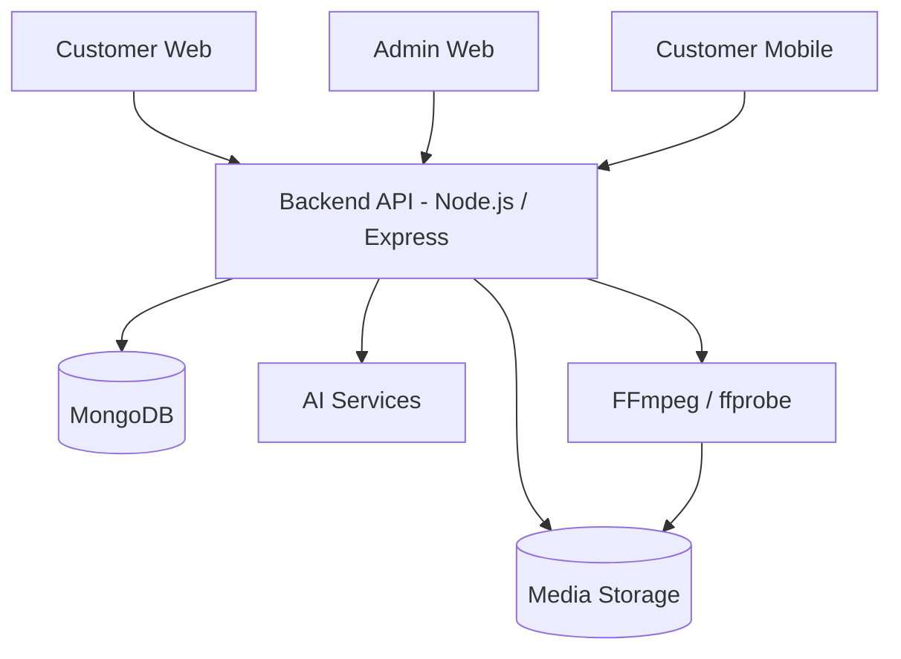
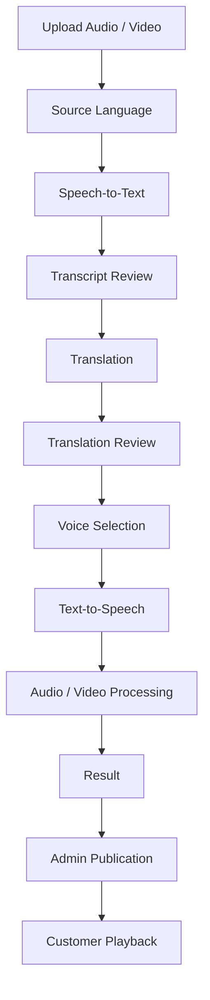

# Multilingual AI Narration

Hệ thống thuyết minh bảo tàng đa ngôn ngữ ứng dụng trí tuệ nhân tạo (AI), hỗ trợ xử lý âm thanh, video, chuyển giọng nói thành văn bản, dịch thuật và tạo nội dung thuyết minh tự động.

Dự án gồm bốn thành phần chính: **Customer Web, Admin Web, Customer Mobile và Backend API**.

## Mục lục

1. [Giới thiệu dự án](#1-giới-thiệu-dự-án)
2. [Chức năng chính](#2-chức-năng-chính)
3. [Ảnh minh họa giao diện](#3-ảnh-minh-họa-giao-diện)
4. [Kiến trúc hệ thống](#4-kiến-trúc-hệ-thống)
5. [Technology Stack](#5-technology-stack)
6. [Cấu trúc thư mục](#6-cấu-trúc-thư-mục)
7. [Quy trình xử lý AI](#7-quy-trình-xử-lý-ai)
8. [Docker Local Deployment](#8-docker-local-deployment)
9. [Cài đặt và chạy thủ công](#9-cài-đặt-và-chạy-thủ-công)
10. [Chạy Mobile Android](#10-chạy-mobile-android)

---

## 1. Giới thiệu dự án

**Multilingual AI Narration** là hệ thống hỗ trợ tạo và quản lý nội dung thuyết minh bảo tàng bằng công nghệ trí tuệ nhân tạo.

Hệ thống cho phép người dùng tải lên tệp âm thanh hoặc video, chuyển đổi giọng nói thành văn bản, dịch nội dung sang ngôn ngữ khác và tạo giọng đọc thuyết minh bằng AI.

Các nội dung được quản lý theo dự án. Người dùng có thể theo dõi tiến trình xử lý, xem kết quả và tải xuống các tệp được tạo.

Quản trị viên quản lý người dùng, dự án, trạng thái xử lý và việc công khai nội dung thuyết minh phục vụ khách tham quan.

Hệ thống gồm:

- **Customer Web:** Giao diện dành cho người dùng.
- **Admin Web:** Giao diện quản trị hệ thống.
- **Customer Mobile:** Ứng dụng dành cho người dùng trên thiết bị di động.
- **Backend API:** Xử lý nghiệp vụ, xác thực, dữ liệu và các tác vụ AI.

---

## 2. Chức năng chính

| Thành phần | Chức năng |
|---|---|
| Customer Web | Đăng ký, đăng nhập, quản lý dự án, tải tệp, chỉnh sửa transcript, dịch nội dung, lựa chọn giọng đọc, theo dõi xử lý, thư viện và xem kết quả |
| Admin Web | Dashboard, quản lý người dùng, dự án, ProcessingJob, ngôn ngữ, giọng đọc, nhật ký hệ thống và duyệt nội dung công khai |
| Customer Mobile | Quản lý và xem nội dung thuyết minh, truy cập bảo tàng, phát âm thanh/video và xem kết quả theo ngôn ngữ |
| Backend API | Xác thực JWT, phân quyền RBAC, quản lý dữ liệu, upload, STT, Translation, TTS, FFmpeg và ProcessingJob |

### Các chức năng AI

- **Speech-to-Text (STT):** Chuyển giọng nói trong âm thanh/video thành văn bản.
- **Translation:** Dịch nội dung thuyết minh sang ngôn ngữ khác.
- **Text-to-Speech (TTS):** Tạo giọng đọc AI từ nội dung văn bản.
- **Media Processing:** Xử lý âm thanh và tạo video MP4 bằng FFmpeg.
- **Result Management:** Quản lý kết quả theo dự án, ngôn ngữ và phiên bản nội dung.
- **Content Publication:** Quản trị viên xét duyệt nội dung được công khai.

---

## 3. Ảnh minh họa giao diện

### Customer Web

Các giao diện chính:

- Trang chủ và giới thiệu bảo tàng.
- Dashboard.
- Danh sách dự án.
- Tạo dự án.
- Thư viện.
- Trang kết quả thuyết minh.

### Admin Web

Các giao diện chính:

- Dashboard quản trị.
- Quản lý người dùng.
- Quản lý dự án.
- Quản lý tiến trình xử lý.
- Quản lý nội dung công khai.

### Customer Mobile

Các giao diện chính:

- Trang chủ.
- Danh sách dự án.
- Tạo dự án.
- Thư viện.
- Trình phát âm thanh và video.

> Ảnh chụp giao diện thực tế sẽ được bổ sung vào README sau khi hoàn thiện bộ screenshot.

---

## 4. Kiến trúc hệ thống

Hệ thống sử dụng kiến trúc Client–Server. Các ứng dụng Web và Mobile giao tiếp với Backend thông qua REST API.

Backend chịu trách nhiệm xác thực, xử lý nghiệp vụ, kết nối MongoDB và tích hợp các dịch vụ AI.



### Các thành phần

**Frontend:** Customer Web và Admin Web được xây dựng bằng React và TypeScript. Customer Mobile sử dụng React Native và Expo.

**Backend:** Sử dụng Node.js, Express và TypeScript để cung cấp REST API và thực hiện các tác vụ xử lý.

**Database:** MongoDB lưu trữ người dùng, dự án, nội dung thuyết minh, kết quả và trạng thái xử lý.

**AI Services:** Hỗ trợ chuyển giọng nói thành văn bản, dịch thuật và tổng hợp giọng đọc.

**Media Processing:** FFmpeg và ffprobe phục vụ kiểm tra, chuyển đổi và xử lý tệp âm thanh/video.

Tài liệu chi tiết:

- [System Architecture](docs/ARCHITECTURE.md)
- [API Documentation](docs/API.md)

---

## 5. Technology Stack

| Layer | Technologies |
|---|---|
| Backend | Node.js 22, Express 5, TypeScript |
| Frontend Web | React 19, TypeScript, Vite 8 |
| Mobile | React Native, Expo SDK 58, Expo Router |
| Database | MongoDB, Mongoose |
| Authentication | JWT, bcryptjs, RBAC |
| Validation | Zod |
| AI Integration | Google Gemini, AI provider adapters |
| Media Processing | FFmpeg, ffprobe |
| Containerization | Docker, Docker Compose |
| Web Server | Nginx |
| CI/CD | GitHub Actions |
| Version Control | Git, GitHub |

Các phiên bản dependency cụ thể được quản lý trong `package.json` và `package-lock.json` của từng ứng dụng.

---

## 6. Cấu trúc thư mục

```text
multilingual-ai-narration/
│
├── backend/
│   ├── src/
│   ├── Dockerfile
│   └── package.json
│
├── frontend-web/
│   └── package.json
│
├── admin-web/
│   └── package.json
│
├── frontend-mobile/
│   └── package.json
│
├── infra/
│   └── local-cd/
│       └── acceptance/
│           ├── compose.yaml
│           ├── Invoke-Acceptance.ps1
│           ├── Manage-Local.ps1
│           ├── mongo-init.js
│           └── mongo-init.test.mjs
│
├── design/
├── docs/
├── scripts/
├── test-media/
│
├── .github/
│   └── workflows/
│
├── .gitignore
├── README.md
└── vercel.json
```

**Mô tả:**

- `backend/`: REST API và các dịch vụ xử lý AI.
- `frontend-web/`: Giao diện Customer Web.
- `admin-web/`: Giao diện quản trị.
- `frontend-mobile/`: Ứng dụng Mobile.
- `infra/`: Cấu hình Docker và công cụ triển khai, kiểm thử.
- `design/`: Tài liệu thiết kế giao diện.
- `docs/`: Tài liệu kỹ thuật dự án.
- `scripts/`: Các công cụ hỗ trợ phát triển.
- `.github/workflows/`: Cấu hình GitHub Actions.

---

## 7. Quy trình xử lý AI

Quy trình tạo nội dung thuyết minh gồm các bước:



### Mô tả quy trình

1. **Upload:** Người dùng tải lên tệp âm thanh hoặc video.
2. **Speech-to-Text:** Hệ thống chuyển giọng nói thành văn bản.
3. **Transcript Review:** Người dùng kiểm tra và chỉnh sửa nội dung.
4. **Translation:** Nội dung được dịch sang ngôn ngữ đích.
5. **Translation Review:** Kiểm tra nội dung bản dịch.
6. **Voice Selection:** Người dùng lựa chọn giọng đọc.
7. **Text-to-Speech:** Hệ thống tổng hợp giọng đọc AI.
8. **Media Processing:** Xử lý âm thanh và tạo video MP4 khi phù hợp.
9. **Result:** Lưu trữ kết quả theo dự án và ngôn ngữ.
10. **Publication:** Quản trị viên xét duyệt nội dung công khai.

Hệ thống sử dụng ProcessingJob để quản lý trạng thái các tác vụ xử lý.

Các kết quả âm thanh và video được quản lý độc lập. Nội dung chỉ được công khai khi đáp ứng điều kiện và được quản trị viên phê duyệt.

---

## 8. Docker Local Deployment

Dự án đã triển khai môi trường kiểm thử Docker Local gồm bốn dịch vụ:

| Service | Chức năng | Truy cập |
|---|---|---|
| MongoDB | Database | Docker internal network |
| Backend | REST API | Docker internal network |
| Customer Web | Giao diện người dùng | http://127.0.0.1:5280 |
| Admin Web | Giao diện quản trị | http://127.0.0.1:5281 |

Docker Compose project:

`narration-s424-acceptance`

Môi trường này sử dụng MongoDB local riêng, không kết nối MongoDB Atlas hoặc các dịch vụ AI LIVE.

### 8.1. Kiểm tra Docker

Mở PowerShell tại thư mục gốc dự án:

```powershell
docker.exe version
docker.exe compose version
```

Để sử dụng các script Docker Local, cần Docker Desktop chạy Linux containers và PowerShell 5.1 trở lên.

### 8.2. Build và Preflight

Script:

`infra/local-cd/acceptance/Invoke-Acceptance.ps1`

Hỗ trợ hai giai đoạn:

- **Build:** Đóng gói source và xây dựng Docker images.
- **Preflight:** Kiểm tra cấu hình, images, ports và các tài nguyên trước khi triển khai.

Ví dụ dành cho môi trường mới chưa có tài nguyên S42.4:

```powershell
docker.exe image inspect mongo:8.0.17 --format '{{.Id}}'

$runId = 's424-20261116-example01'

powershell -File infra/local-cd/acceptance/Invoke-Acceptance.ps1 -Stage Build -RunId $runId

powershell -File infra/local-cd/acceptance/Invoke-Acceptance.ps1 -Stage Preflight -RunId $runId
```

Lưu ý:

- Image `mongo:8.0.17` phải tồn tại trên máy.
- Không chạy lại Build/Preflight trên stack đã tồn tại để vượt qua các ownership guards.
- Build và Preflight không tự động triển khai toàn bộ hệ thống.
- Việc triển khai mới từ source chưa được nghiệm thu đầy đủ trên máy khác.

### 8.3. Quản lý Docker Local

Script:

`infra/local-cd/acceptance/Manage-Local.ps1`

Script hỗ trợ bốn thao tác: **Start, Stop, Status và Logs**.

**Kiểm tra trạng thái:**

```powershell
powershell -File infra/local-cd/acceptance/Manage-Local.ps1 -Action Status
```

**Xem Backend logs:**

```powershell
powershell -File infra/local-cd/acceptance/Manage-Local.ps1 -Action Logs -Service backend -Tail 50
```

**Khởi động container hiện có:**

```powershell
powershell -File infra/local-cd/acceptance/Manage-Local.ps1 -Action Start
```

**Dừng container:**

```powershell
powershell -File infra/local-cd/acceptance/Manage-Local.ps1 -Action Stop
```

Script quản lý chỉ hỗ trợ stack đã nghiệm thu trên máy hiện tại, sử dụng RunId:

`s424-20261115t215313`

Script xác minh manifest, journal, container IDs và image IDs trước khi thao tác. Nó phụ thuộc vào dữ liệu nghiệm thu local trong `.state`, không được đưa lên GitHub.

**Không chạy Start/Stop khi đang có tác vụ quan trọng.** Hai thao tác này chưa được nghiệm thu runtime đầy đủ.

### 8.4. Kiểm tra các container

```powershell
docker ps -a --filter "label=com.docker.compose.project=narration-s424-acceptance"
```

Kiểm tra ứng dụng:

- Customer Web: http://127.0.0.1:5280
- Admin Web: http://127.0.0.1:5281

Có thể kiểm tra HTTP health thông qua:

```text
http://127.0.0.1:5280/api/health
http://127.0.0.1:5281/api/health
```

### 8.5. Kết quả kiểm thử Docker

| Hạng mục | Kết quả |
|---|---|
| Docker images build | PASS |
| MongoDB, Backend, Customer Web, Admin Web | 4/4 HEALTHY |
| MongoDB replica set | PRIMARY |
| HTTP/API smoke | PASS |
| MongoDB regression tests | 26/26 PASS |
| Management script static tests | PASS |
| Backup/Restore | Chưa nghiệm thu |
| Runtime Stop/Start | Chưa nghiệm thu |
| Production/Multi-machine deployment | Chưa nghiệm thu |

Kết quả trên thuộc môi trường nghiệm thu local. Chúng không chứng minh toàn bộ quy trình AI LIVE, xử lý media thực tế hoặc production deployment đã hoàn tất.

---

## 9. Cài đặt và chạy thủ công

Ngoài Docker, các thành phần có thể chạy riêng trong môi trường phát triển.

### 9.1. Clone repository

```powershell
git clone https://github.com/vuvantai14/multilingual-ai-narration.git

cd multilingual-ai-narration
```

Sử dụng phiên bản Node.js được khai báo trong `.nvmrc` và chuẩn bị MongoDB replica set hoặc MongoDB Atlas phù hợp.

Trước khi chạy, tạo `.env` từ `.env.example` trong từng ứng dụng và điền cấu hình cần thiết.

Tham khảo:

[Local Development](docs/LOCAL_DEVELOPMENT.md)

### 9.2. Chạy Backend

Mở terminal thứ nhất:

```powershell
cd backend

npm ci

if (!(Test-Path .env)) {
    Copy-Item .env.example .env
}

npm run dev
```

Cần cấu hình MongoDB URI, JWT secrets và các biến bắt buộc trước khi chạy.

Backend API mặc định:

```text
http://localhost:8080/api
```

Health endpoint:

```text
http://localhost:8080/api/health
```

### 9.3. Chạy Customer Web

Mở terminal mới tại thư mục gốc dự án:

```powershell
cd frontend-web

npm ci

if (!(Test-Path .env)) {
    Copy-Item .env.example .env
}

$env:VITE_API_BASE_URL = 'http://localhost:8080/api'

npm run dev -- --port 5173 --strictPort
```

Truy cập:

http://localhost:5173

### 9.4. Chạy Admin Web

Mở terminal mới tại thư mục gốc dự án:

```powershell
cd admin-web

npm ci

if (!(Test-Path .env)) {
    Copy-Item .env.example .env
}

$env:VITE_API_BASE_URL = 'http://localhost:8080/api'

$env:VITE_PUBLIC_MUSEUM_URL = 'http://localhost:5173/'

npm run dev
```

Truy cập:

http://localhost:5174

Admin Web yêu cầu tài khoản có quyền quản trị hợp lệ.

### 9.5. Build ứng dụng

Trong thư mục của từng ứng dụng:

```powershell
npm run build
```

Đối với Backend, sau khi build có thể chạy production entry bằng:

```powershell
npm start
```

Các lệnh `npm run dev` phục vụ môi trường phát triển, không phải cấu hình production hosting.

---

## 10. Chạy Mobile Android

Customer Mobile được phát triển bằng React Native và Expo.

### 10.1. Chuẩn bị

- Node.js và npm.
- Android Studio.
- Android SDK.
- Android Emulator hoặc thiết bị Android.
- Backend API có thể truy cập từ thiết bị.

### 10.2. Cài đặt

Từ thư mục gốc dự án:

```powershell
cd frontend-mobile

npm ci

if (!(Test-Path .env)) {
    Copy-Item .env.example .env
}
```

### 10.3. Chạy Android Emulator

Với Android Emulator mặc định, sử dụng địa chỉ `10.0.2.2` để truy cập Backend trên máy host.

```powershell
$env:EXPO_PUBLIC_API_BASE_URL = 'http://10.0.2.2:8080/api'

npm run android
```

Cần khởi động Android Emulator trước khi chạy ứng dụng.

### 10.4. Chạy trên thiết bị Android thật

Khi sử dụng điện thoại thật, cấu hình API bằng địa chỉ IP LAN của máy chạy Backend.

Ví dụ:

```text
EXPO_PUBLIC_API_BASE_URL=http://192.168.1.10:8080/api
```

Địa chỉ trên chỉ là ví dụ; cần thay bằng IP thực tế.

Điện thoại và Backend phải có kết nối mạng phù hợp. Backend cũng phải cho phép truy cập qua địa chỉ LAN và firewall.

### 10.5. Kiểm tra Mobile

```powershell
npm run typecheck

npm run lint

npm test
```

Xuất Android bundle:

```powershell
npx expo export --platform android --output-dir .expo/android-export
```

Bundle export không phải APK/AAB và không thay thế kiểm thử runtime trên thiết bị Android.

---

## Tài liệu tham khảo

- [Architecture](docs/ARCHITECTURE.md)
- [API](docs/API.md)
- [Local Development](docs/LOCAL_DEVELOPMENT.md)
- [Project Progress](docs/PROGRESS.md)
- [UI Documentation](docs/UI.md)

---

**Multilingual AI Narration — AI-powered Multilingual Museum Narration System**
